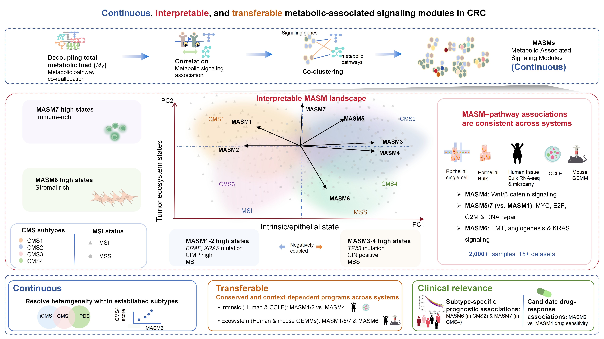

Metabolic Allocation Anchors Continuous Signaling States Across Colorectal Cancer Ecosystems
---------------------------------------------------------------------------------------
This resource provides the R code and processed data to reproduce key results described in Dan H, et al.Metabolic Allocation Anchors Continuous Signaling States Across Colorectal Cancer Ecosystems
### Getting started
**1.** Clone Github repository. 
**1.** Clone Github repository and get the data from google drive. 
```
https://github.com/danhuang0909/metabolic-allocation.git
```
download the data from the  following link and store them in the ./data folder
https://www.synapse.org/Synapse:syn64302025/files/





**2.** Run the following script to get the figures and supplementary figures
```
# Figure 1 and Supplementary Figures 1-2
Rscript Rscript/step1_figure1.R

# Figure 2 and Supplementary Figures 3-8
Rscript Rscript/step1_figure2.R

# Figure 3 and Supplementary Figure 9
Rscript Rscript/step1_figure3.R

# Figure 4 and Supplementary Figures 9-11
Rscript Rscript/step1_figure4.R

# Figure 5, Supplementary Figure 12, and additional subtype,
# clinical, drug-response, and supplementary outputs
Rscript Rscript/step1_figure5.R

# Figure 6 and Supplementary Figure 13
Rscript Rscript/step1_figure6.R

# Figure 7 and Supplementary Figure 14
Rscript Rscript/step1_figure7.R
```
### Contact
danhuang2018dana@gmail.com
